
<a href="README.md">English</a> · <b>Español</b>

  <a href="https://cristianperez.me/es">
  <picture>
    <source media="(prefers-color-scheme: dark)" srcset="./assets/cover-es-dark.svg" />
    
  </picture>
  </a>

  
  
  
  

  
  
  
  

 

<picture>
  <source media="(prefers-color-scheme: dark)" srcset="./assets/stand-es-dark.svg" />
  
</picture>

 

Soy Cristian, Cris: Ingeniero de Sistemas de la UNAB y desarrollador full-stack en Bucaramanga, Colombia. Hago páginas web, apps y software a la medida para negocios, de la primera llamada al despliegue, y subo videos como Tostu. Algunos se volvieron virales (32K+ seguidores en TikTok).

Cofundé [Carpy](https://carpy.tech), un estudio de software pequeño. Hacemos software a la medida, páginas web, integraciones y auditorías de seguridad para clientes en Colombia y afuera. Mi tesis, PairSync, ya está terminada. Lo de seguridad viene de trabajar con el equipo de ciberseguridad de la Fundación Cardiovascular de Colombia.

Hay más de diez páginas publicadas para negocios reales, como Cruz Blanca (un restaurante en Girón con pedidos en línea) y Jovi's Gioielli (una joyería en Italia con vista previa del grabado en vivo). Por diversión también hice [Tostrivia](https://tostrivia-gg.vercel.app), un juego de trivia para jugar con amigos, y [Radar K-pop](https://radar-kpop.vercel.app), un globo que muestra dónde de gira van los grupos de K-pop.

> **Cotizaciones abiertas.** Una página que venda, una app que tu equipo sí use o el sistema que tu negocio ya superó: cuéntame qué necesitas y te mando un precio.

 

<picture>
  <source media="(prefers-color-scheme: dark)" srcset="./assets/part-2-es-dark.svg" />
  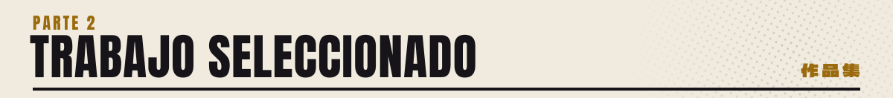
</picture>

<a href="https://tostrivia-gg.vercel.app">
<picture>
  <source media="(prefers-color-scheme: dark)" srcset="./assets/cards/tostrivia-es-dark-v4.jpg" />
  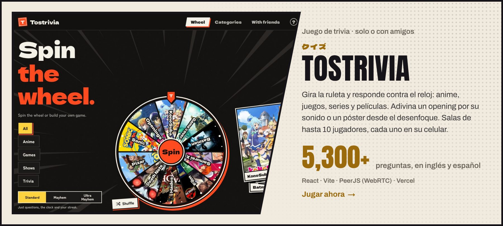
</picture>
</a>

<a href="https://radar-kpop.vercel.app">
<picture>
  <source media="(prefers-color-scheme: dark)" srcset="./assets/cards/radar-kpop-es-dark-v4.jpg" />
  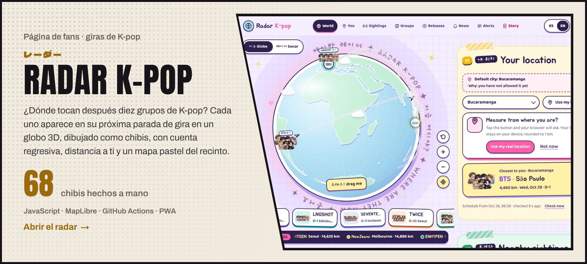
</picture>
</a>

<a href="https://carpy.tech">
<picture>
  <source media="(prefers-color-scheme: dark)" srcset="./assets/cards/carpy-es-dark-v4.jpg" />
  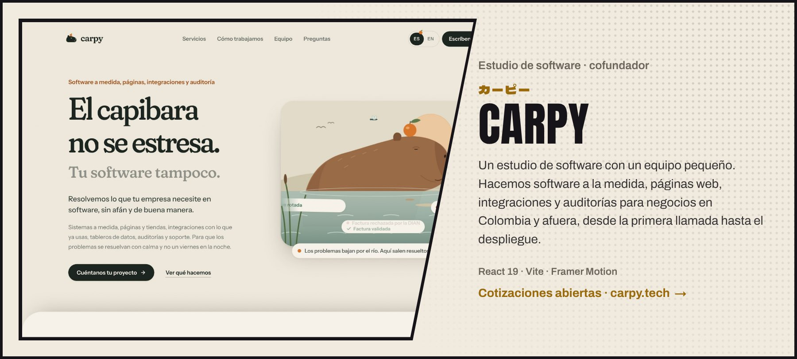
</picture>
</a>

<a href="https://cruz-blanca-red.vercel.app/">
<picture>
  <source media="(prefers-color-scheme: dark)" srcset="./assets/cards/cruz-blanca-es-dark-v4.jpg" />
  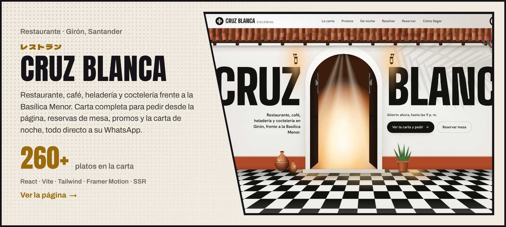
</picture>
</a>

<a href="https://www.tiktok.com/@criscx1905">
<picture>
  <source media="(prefers-color-scheme: dark)" srcset="./assets/cards/content-es-dark-v4.jpg" />
  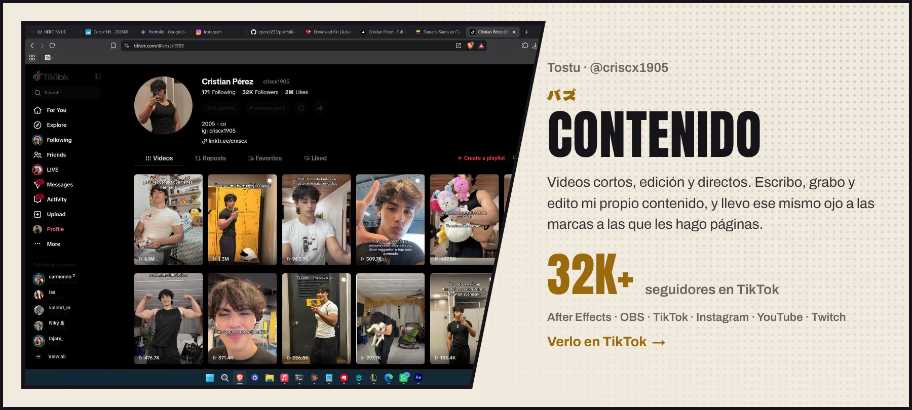
</picture>
</a>

  <a href="https://github.com/cperez233/digitalizacion-actas-fcv"><picture><source media="(prefers-color-scheme: dark)" srcset="./assets/cards/actas-fcv-es-dark-v4.jpg" />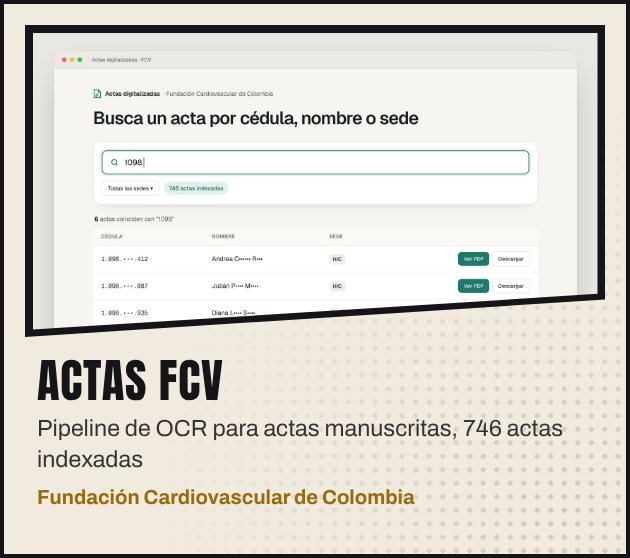</picture></a>
  <a href="https://github.com/cperez233/guardenv"><picture><source media="(prefers-color-scheme: dark)" srcset="./assets/cards/guardenv-es-dark-v4.jpg" />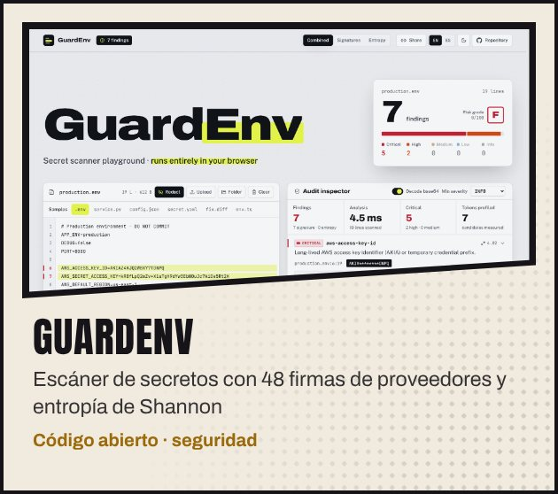</picture></a>
  <a href="https://joyeria-liart.vercel.app/"><picture><source media="(prefers-color-scheme: dark)" srcset="./assets/cards/jovis-gioielli-es-dark-v4.jpg" />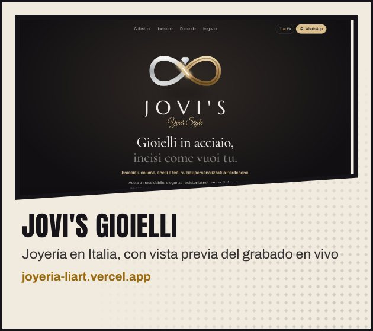</picture></a>
  <a href="https://sammy-three-alpha.vercel.app/"><picture><source media="(prefers-color-scheme: dark)" srcset="./assets/cards/sammy-partyboom-es-dark-v4.jpg" />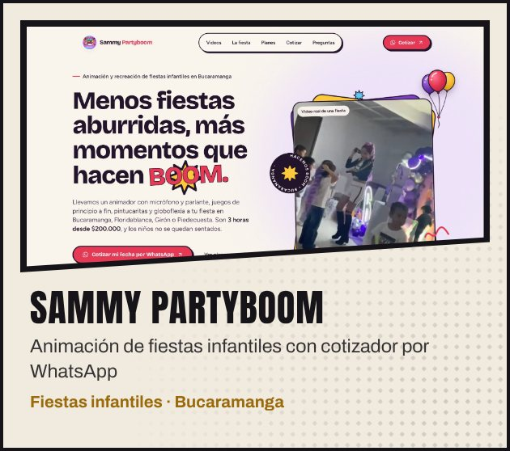</picture></a>
  <a href="https://hotellogistico.com"><picture><source media="(prefers-color-scheme: dark)" srcset="./assets/cards/hotel-logistico-es-dark-v4.jpg" />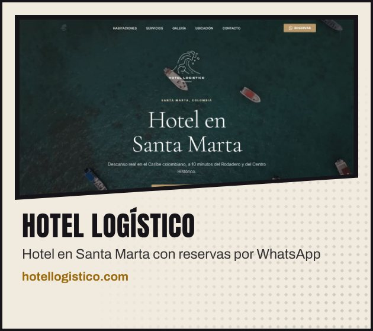</picture></a>
  <a href="https://carros-2.vercel.app/"><picture><source media="(prefers-color-scheme: dark)" srcset="./assets/cards/master-service-quality-es-dark-v4.jpg" />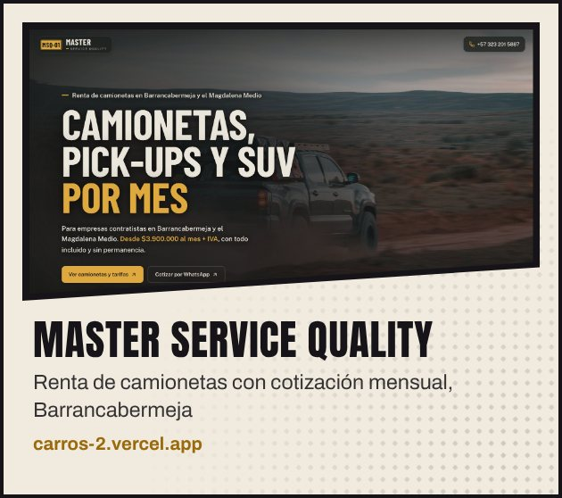</picture></a>
  <a href="https://the-groomers-house.vercel.app/"><picture><source media="(prefers-color-scheme: dark)" srcset="./assets/cards/groomers-house-es-dark-v4.jpg" />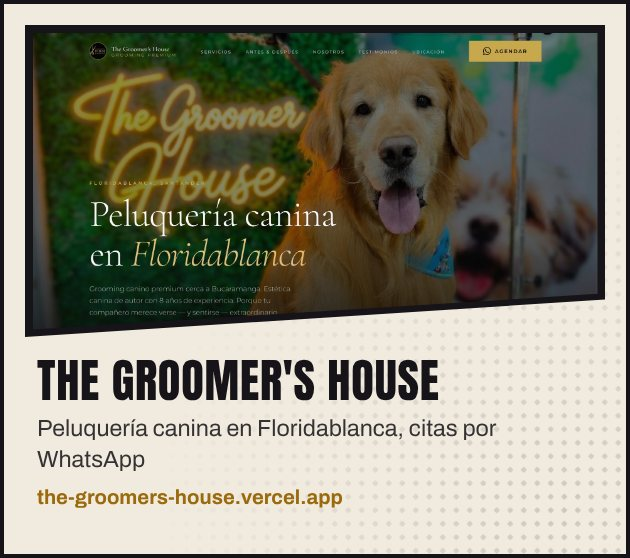</picture></a>
  <a href="https://calzadoleons.com"><picture><source media="(prefers-color-scheme: dark)" srcset="./assets/cards/leons-es-dark-v4.jpg" />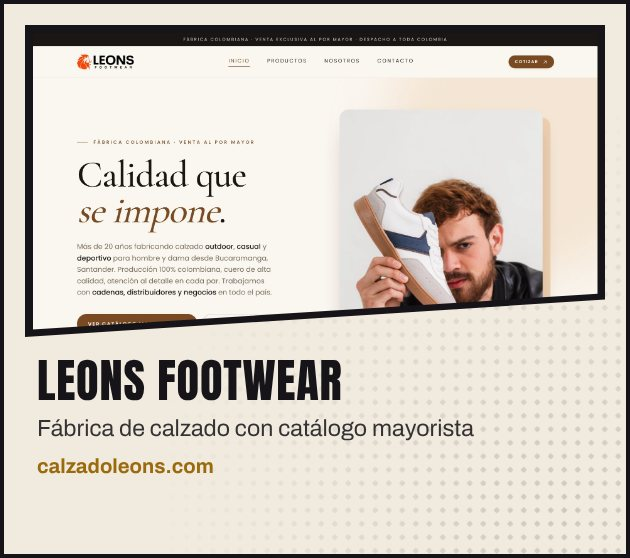</picture></a>
  <a href="https://louloz.com"><picture><source media="(prefers-color-scheme: dark)" srcset="./assets/cards/louloz-es-dark-v4.jpg" />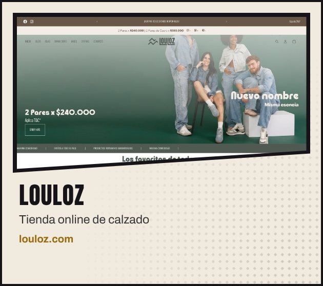</picture></a>
  <a href="https://elrincondelbebebga.com/"><picture><source media="(prefers-color-scheme: dark)" srcset="./assets/cards/rincon-del-bebe-es-dark-v4.jpg" />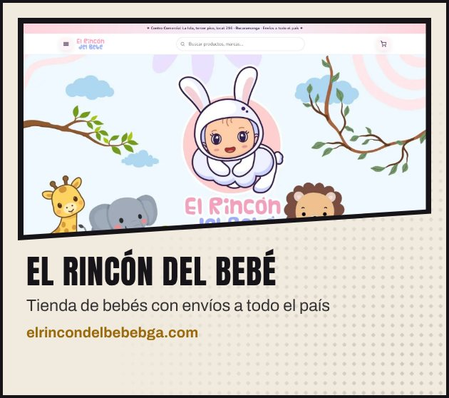</picture></a>
  <a href="https://www.m10drinkslicorera.com/"><picture><source media="(prefers-color-scheme: dark)" srcset="./assets/cards/m10-drinks-es-dark-v4.jpg" />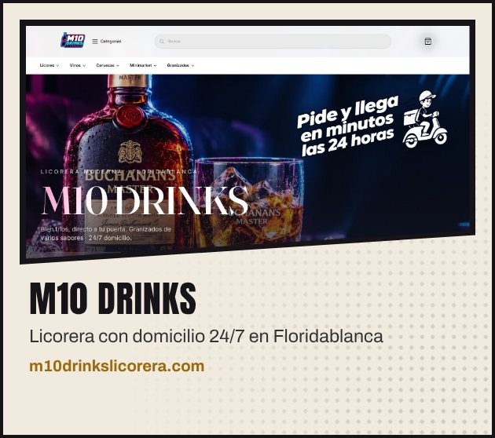</picture></a>
  <a href="https://github.com/cperez233/pass-guard"><picture><source media="(prefers-color-scheme: dark)" srcset="./assets/cards/passguard-es-dark-v4.jpg" />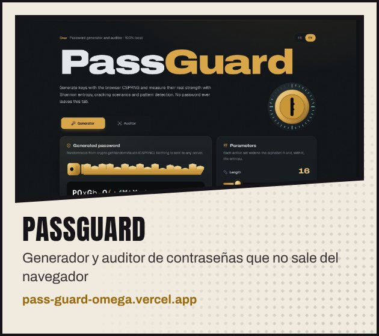</picture></a>
  <a href="https://github.com/cperez233/PairProgramming"><picture><source media="(prefers-color-scheme: dark)" srcset="./assets/cards/pairsync-es-dark-v4.jpg" />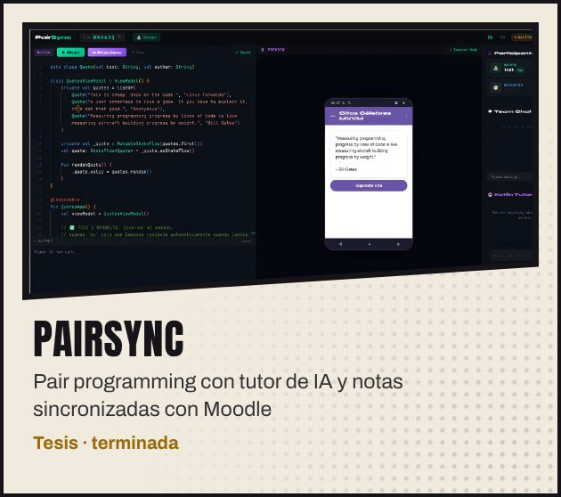</picture></a>
  <a href="https://cristianperez.me/es"><picture><source media="(prefers-color-scheme: dark)" srcset="./assets/cards/portfolio-es-dark-v4.jpg" />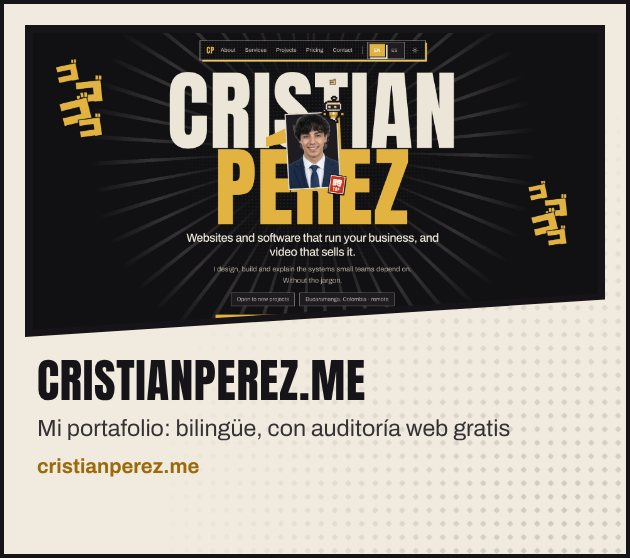</picture></a>

<a href="https://cristianperez.me/es"><b>Más trabajo y precios en cristianperez.me →</b></a>

 

<picture>
  <source media="(prefers-color-scheme: dark)" srcset="./assets/part-3-es-dark.svg" />
  
</picture>

<picture>
  <source media="(prefers-color-scheme: dark)" srcset="./assets/arsenal-es-dark.svg" />
  
</picture>

<picture>
  <source media="(prefers-color-scheme: dark)" srcset="./assets/languages-es-dark.svg" />
  
</picture>

 

<picture>
  <source media="(prefers-color-scheme: dark)" srcset="./assets/part-4-es-dark.svg" />
  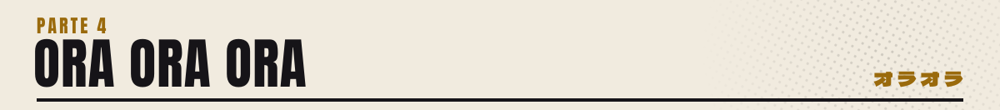
</picture>

<a href="https://github.com/cperez233">
<picture>
  <source media="(prefers-color-scheme: dark)" srcset="https://raw.githubusercontent.com/cperez233/cperez233/output/ora-es-dark.svg" />
  
</picture>
</a>

<picture>
  <source media="(prefers-color-scheme: dark)" srcset="https://raw.githubusercontent.com/cperez233/cperez233/output/streak-es-dark.svg" />
  
</picture>

 

<picture>
  <source media="(prefers-color-scheme: dark)" srcset="./assets/approach-es-dark.svg" />
  
</picture>

  
  
  

O escríbeme directo a <a href="mailto:crisperezm879@gmail.com">crisperezm879@gmail.com</a>

 

<picture>
  <source media="(prefers-color-scheme: dark)" srcset="./assets/tbc-es-dark.svg" />
  
</picture>
