
<a href="README.md">English</a> · <b>Español</b>

  <a href="https://cristianperez.me/es">
  <picture>
    <source media="(prefers-color-scheme: dark)" srcset="./assets/cover-es-dark.svg" />
    
  </picture>
  </a>

  
  
  
  
  
  
  
  

 

<picture>
  <source media="(prefers-color-scheme: dark)" srcset="./assets/part-1-es-dark.svg" />
  
</picture>

Soy Cristian, Cris: Ingeniero de Sistemas de la UNAB, desarrollador full-stack y creador de contenido en Bucaramanga, Colombia. Construyo software, páginas web y apps para negocios, y hago videos como **Tostu**, algunos de los cuales se han vuelto virales en el camino (32K+ seguidores en TikTok).

Cofundé **[Carpy](https://carpy.tech)**, un estudio de software con un equipo detrás: software a la medida, páginas web, integraciones y auditorías de seguridad para clientes en Colombia y afuera. Mi tesis, PairSync, ya está terminada, y el lado de seguridad viene de trabajar con el equipo de ciberseguridad de la Fundación Cardiovascular de Colombia.

> **Cotizaciones abiertas.** Ahora mismo trabajo con clientes y recibo proyectos nuevos: una página que venda, una app que tu equipo sí use o el sistema que tu negocio ya superó. Cuéntame qué necesitas y te mando un precio.

 

<picture>
  <source media="(prefers-color-scheme: dark)" srcset="./assets/stand-es-dark.svg" />
  
</picture>

 

<picture>
  <source media="(prefers-color-scheme: dark)" srcset="./assets/part-2-es-dark.svg" />
  
</picture>

<a href="https://carpy.tech">
<picture>
  <source media="(prefers-color-scheme: dark)" srcset="./assets/cards/carpy-es-dark.jpg" />
  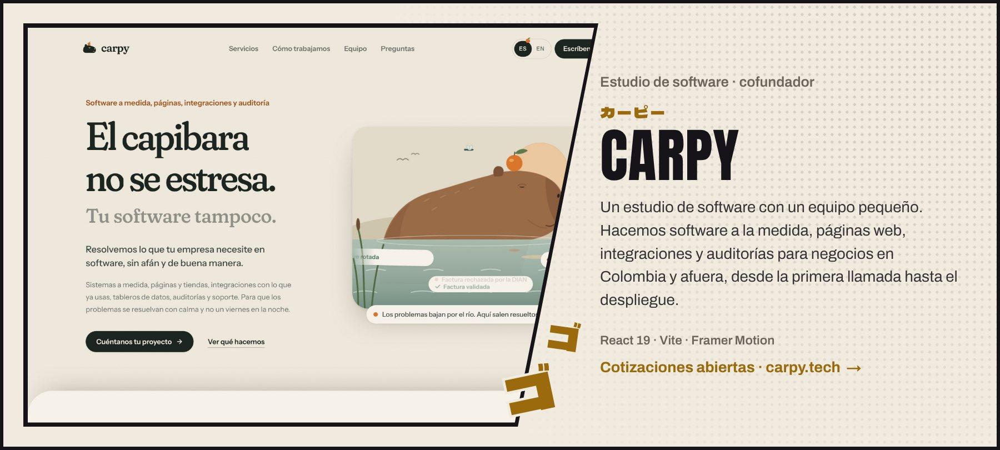
</picture>
</a>

<a href="https://github.com/cperez233/digitalizacion-actas-fcv">
<picture>
  <source media="(prefers-color-scheme: dark)" srcset="./assets/cards/actas-fcv-es-dark.jpg" />
  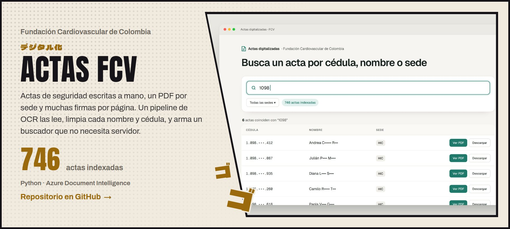
</picture>
</a>

<a href="https://github.com/cperez233/guardenv">
<picture>
  <source media="(prefers-color-scheme: dark)" srcset="./assets/cards/guardenv-es-dark.jpg" />
  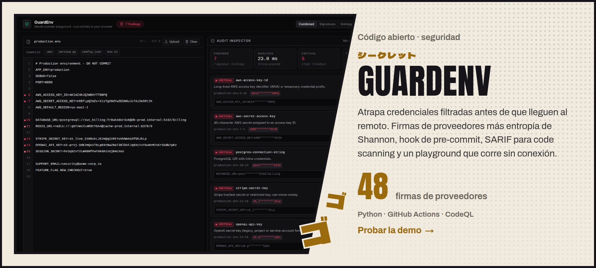
</picture>
</a>

<a href="https://www.tiktok.com/@criscx1905">
<picture>
  <source media="(prefers-color-scheme: dark)" srcset="./assets/cards/content-es-dark.jpg" />
  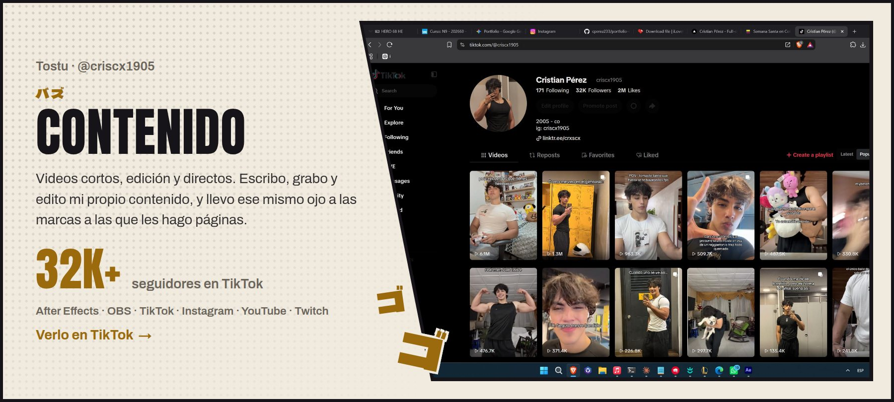
</picture>
</a>

  <a href="https://carros-2.vercel.app/"><picture><source media="(prefers-color-scheme: dark)" srcset="./assets/cards/master-service-quality-es-dark.jpg" />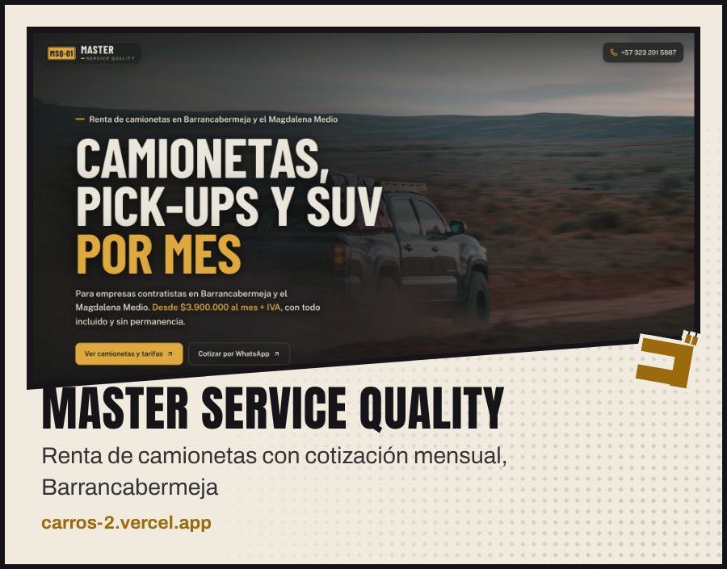</picture></a>
  <a href="https://elrincondelbebebga.com/"><picture><source media="(prefers-color-scheme: dark)" srcset="./assets/cards/rincon-del-bebe-es-dark.jpg" />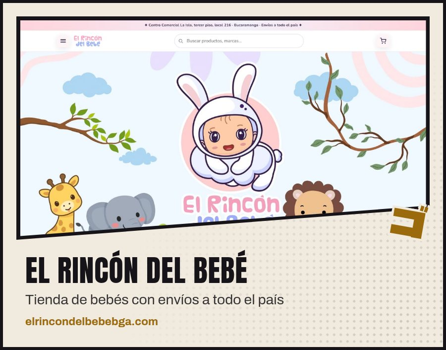</picture></a>
  <a href="https://m10drinksversionfinal.netlify.app/"><picture><source media="(prefers-color-scheme: dark)" srcset="./assets/cards/m10-drinks-es-dark.jpg" />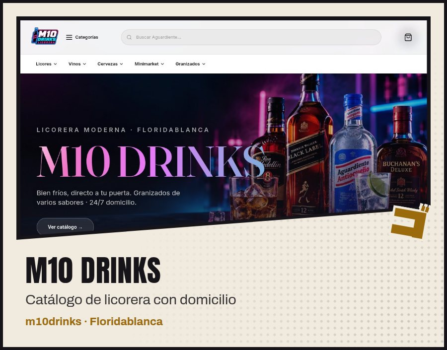</picture></a>
  <a href="https://github.com/cperez233/pass-guard"><picture><source media="(prefers-color-scheme: dark)" srcset="./assets/cards/passguard-es-dark.jpg" />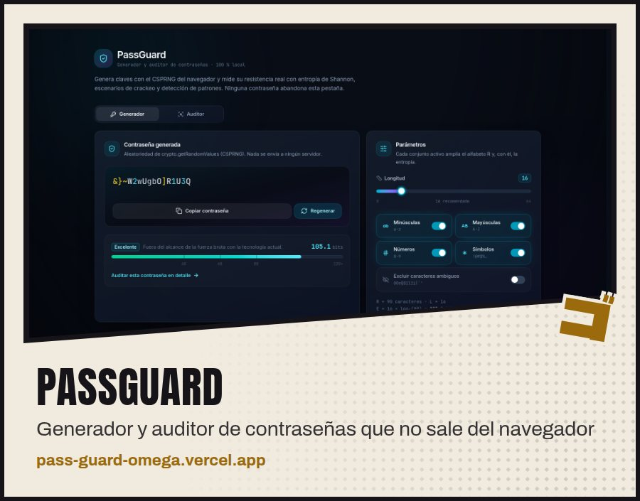</picture></a>
  <a href="https://github.com/cperez233/PairProgramming"><picture><source media="(prefers-color-scheme: dark)" srcset="./assets/cards/pairsync-es-dark.jpg" />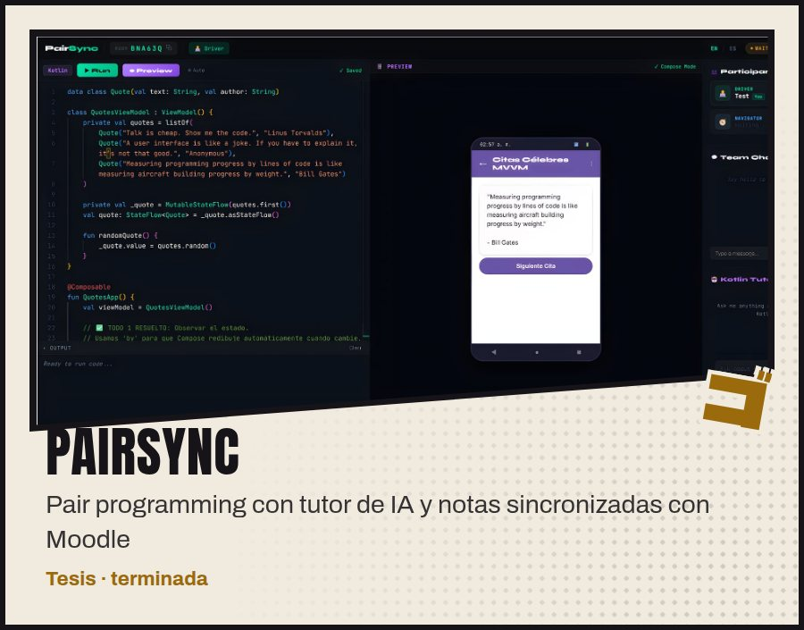</picture></a>
  <a href="https://cristianperez.me"><picture><source media="(prefers-color-scheme: dark)" srcset="./assets/cards/portfolio-es-dark.jpg" />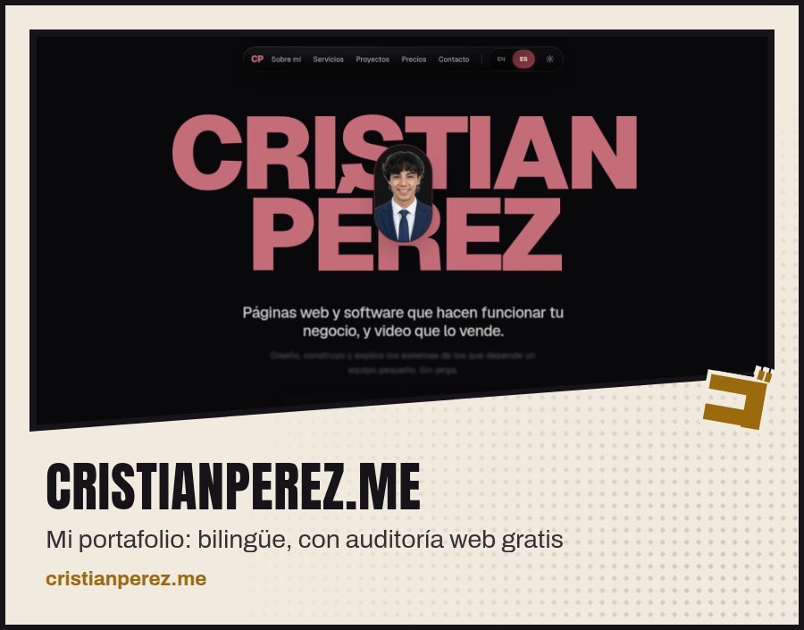</picture></a>

<a href="https://cristianperez.me/es"><b>Más trabajo y precios en cristianperez.me →</b></a>

 

<picture>
  <source media="(prefers-color-scheme: dark)" srcset="./assets/part-3-es-dark.svg" />
  
</picture>

<picture>
  <source media="(prefers-color-scheme: dark)" srcset="./assets/arsenal-es-dark.svg" />
  
</picture>

  <picture>
    <source media="(prefers-color-scheme: dark)" srcset="https://streak-stats.demolab.com/?user=cperez233&locale=es&hide_border=true&border_radius=0&background=111013&stroke=2A272C&ring=E3B341&fire=E3B341&currStreakNum=ECE6D8&sideNums=ECE6D8&currStreakLabel=E3B341&sideLabels=9A948A&dates=9A948A" />
    
  </picture>

 

<picture>
  <source media="(prefers-color-scheme: dark)" srcset="./assets/approach-es-dark.svg" />
  
</picture>

  
  
  

O escríbeme directo a <a href="mailto:crisperezm879@gmail.com">crisperezm879@gmail.com</a>

 

<picture>
  <source media="(prefers-color-scheme: dark)" srcset="./assets/tbc-es-dark.svg" />
  
</picture>
