
<b>English</b> · <a href="README.es.md">Español</a>

  <a href="https://cristianperez.me">
  <picture>
    <source media="(prefers-color-scheme: dark)" srcset="./assets/cover-dark.svg" />
    
  </picture>
  </a>

  
  
  
  

  
  
  
  

 

<picture>
  <source media="(prefers-color-scheme: dark)" srcset="./assets/stand-dark.svg" />
  
</picture>

 

I'm Cristian, Cris for short: a Systems Engineer from UNAB and a full-stack developer based in Bucaramanga, Colombia. I build websites, apps and custom software for businesses, from the first call to the deploy, and I make videos as Tostu. Some of them went viral (32K+ followers on TikTok).

I co-founded [Carpy](https://carpy.tech), a small software studio. We make custom software, websites, integrations and security audits for clients in Colombia and abroad. My thesis, PairSync, is finished. The security side comes from working with the cybersecurity team at Fundación Cardiovascular de Colombia.

More than ten sites are live for real businesses, like Cruz Blanca (a restaurant in Girón with online ordering) and Jovi's Gioielli (a jewelry store in Italy with a live engraving preview). For fun, I also made [Tostrivia](https://tostrivia-gg.vercel.app), a trivia game you can play with friends, and [Radar K-pop](https://radar-kpop.vercel.app), a globe that shows where K-pop groups tour next.

> **Quotes are open.** A website that sells, an app your team will actually use, or the system your business already outgrew: tell me what you need and I'll send you a price.

 

<picture>
  <source media="(prefers-color-scheme: dark)" srcset="./assets/part-2-dark.svg" />
  
</picture>

<a href="https://tostrivia-gg.vercel.app">
<picture>
  <source media="(prefers-color-scheme: dark)" srcset="./assets/cards/tostrivia-dark-v4.jpg" />
  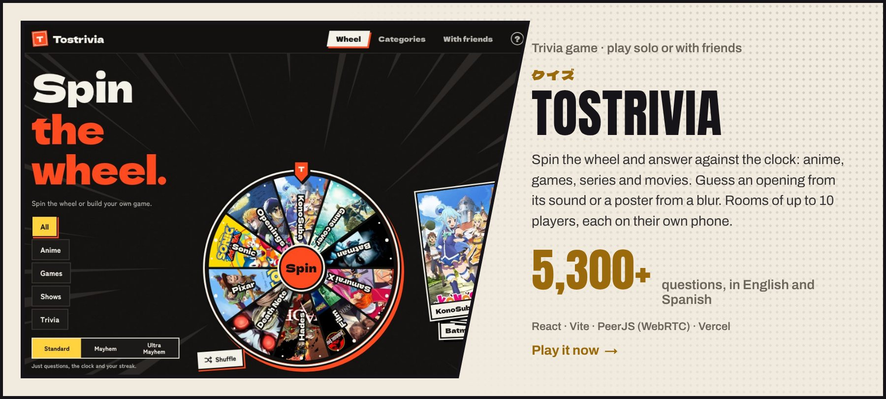
</picture>
</a>

<a href="https://radar-kpop.vercel.app">
<picture>
  <source media="(prefers-color-scheme: dark)" srcset="./assets/cards/radar-kpop-dark-v4.jpg" />
  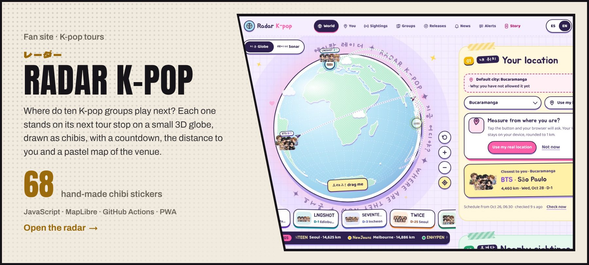
</picture>
</a>

<a href="https://carpy.tech">
<picture>
  <source media="(prefers-color-scheme: dark)" srcset="./assets/cards/carpy-dark-v4.jpg" />
  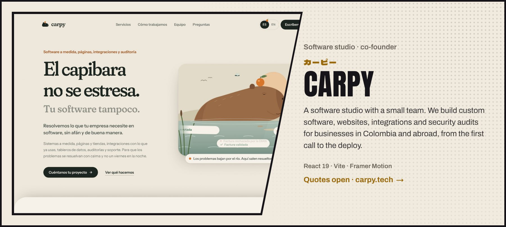
</picture>
</a>

<a href="https://cruz-blanca-red.vercel.app/">
<picture>
  <source media="(prefers-color-scheme: dark)" srcset="./assets/cards/cruz-blanca-dark-v4.jpg" />
  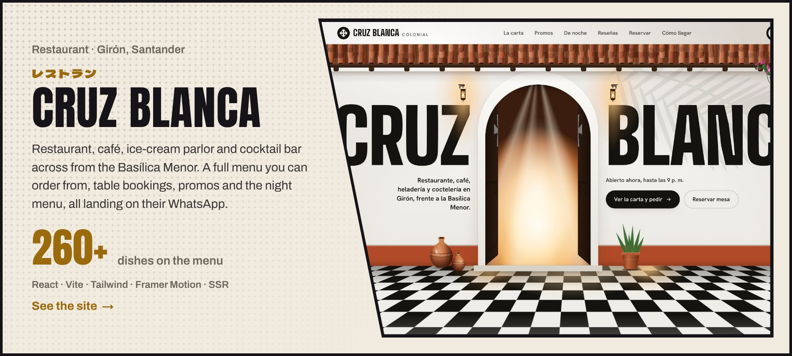
</picture>
</a>

<a href="https://www.tiktok.com/@criscx1905">
<picture>
  <source media="(prefers-color-scheme: dark)" srcset="./assets/cards/content-dark-v4.jpg" />
  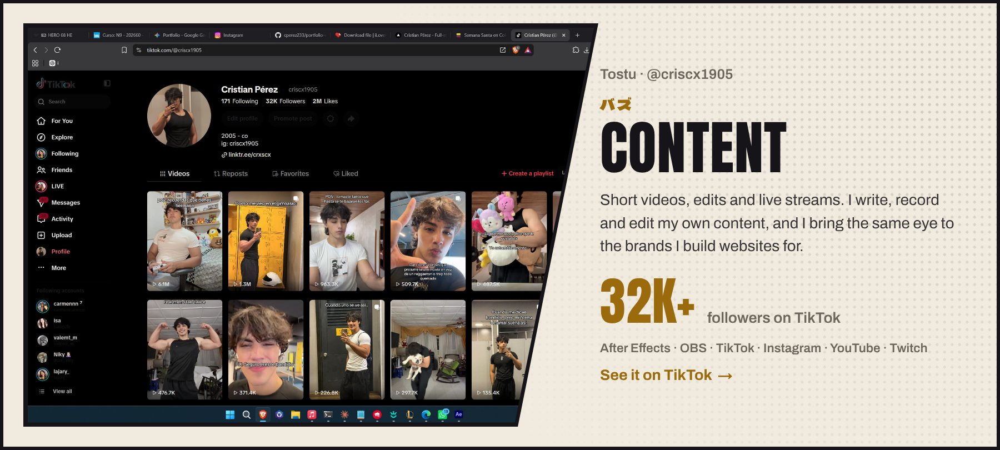
</picture>
</a>

  <a href="https://github.com/cperez233/digitalizacion-actas-fcv"><picture><source media="(prefers-color-scheme: dark)" srcset="./assets/cards/actas-fcv-dark-v4.jpg" />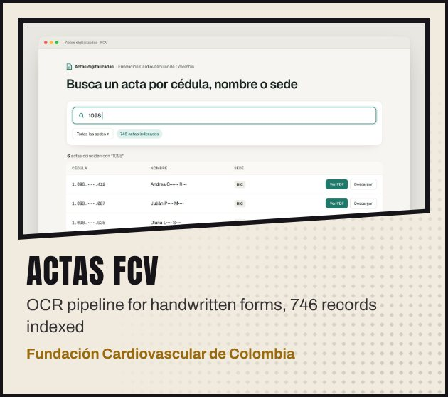</picture></a>
  <a href="https://github.com/cperez233/guardenv"><picture><source media="(prefers-color-scheme: dark)" srcset="./assets/cards/guardenv-dark-v4.jpg" />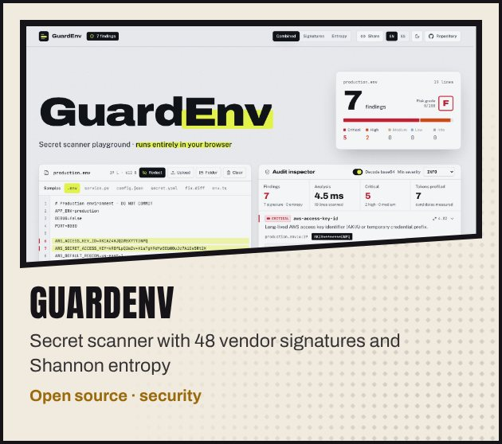</picture></a>
  <a href="https://joyeria-liart.vercel.app/"><picture><source media="(prefers-color-scheme: dark)" srcset="./assets/cards/jovis-gioielli-dark-v4.jpg" />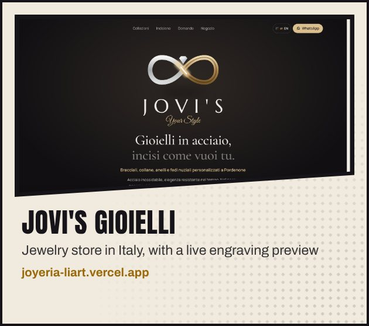</picture></a>
  <a href="https://sammy-three-alpha.vercel.app/"><picture><source media="(prefers-color-scheme: dark)" srcset="./assets/cards/sammy-partyboom-dark-v4.jpg" />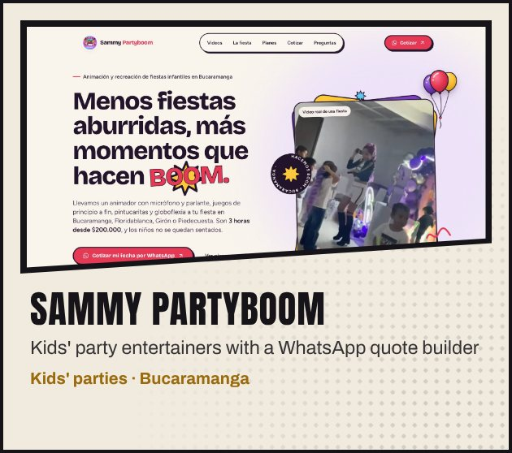</picture></a>
  <a href="https://hotellogistico.com"><picture><source media="(prefers-color-scheme: dark)" srcset="./assets/cards/hotel-logistico-dark-v4.jpg" /></picture></a>
  <a href="https://carros-2.vercel.app/"><picture><source media="(prefers-color-scheme: dark)" srcset="./assets/cards/master-service-quality-dark-v4.jpg" />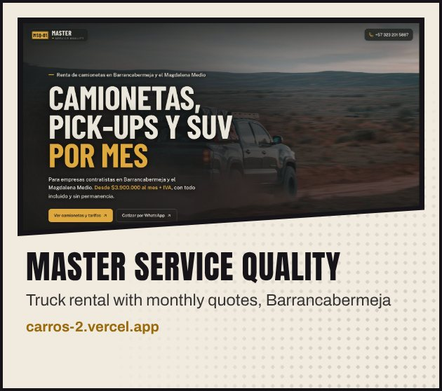</picture></a>
  <a href="https://the-groomers-house.vercel.app/"><picture><source media="(prefers-color-scheme: dark)" srcset="./assets/cards/groomers-house-dark-v4.jpg" />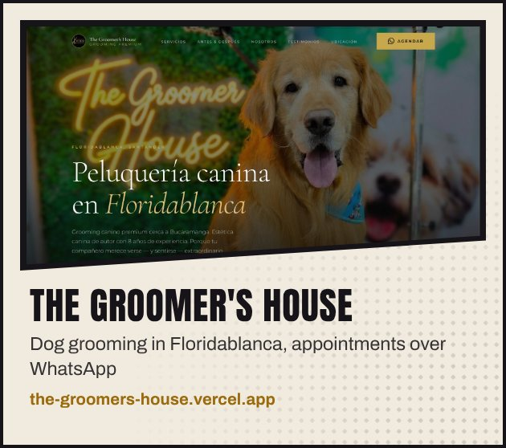</picture></a>
  <a href="https://calzadoleons.com"><picture><source media="(prefers-color-scheme: dark)" srcset="./assets/cards/leons-dark-v4.jpg" />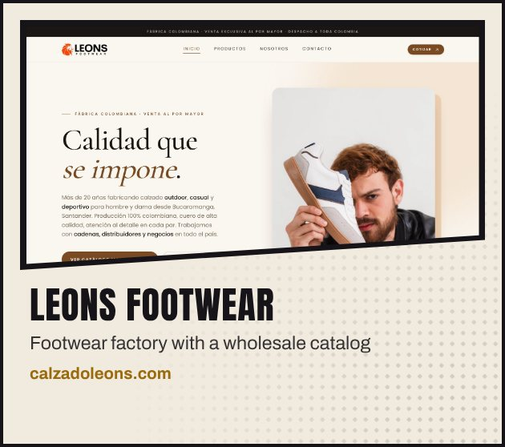</picture></a>
  <a href="https://louloz.com"><picture><source media="(prefers-color-scheme: dark)" srcset="./assets/cards/louloz-dark-v4.jpg" />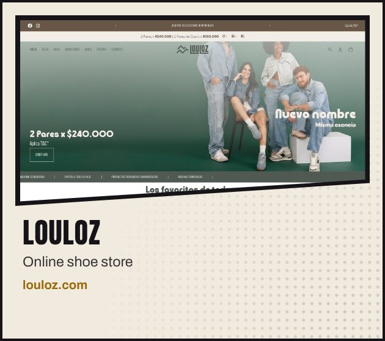</picture></a>
  <a href="https://elrincondelbebebga.com/"><picture><source media="(prefers-color-scheme: dark)" srcset="./assets/cards/rincon-del-bebe-dark-v4.jpg" />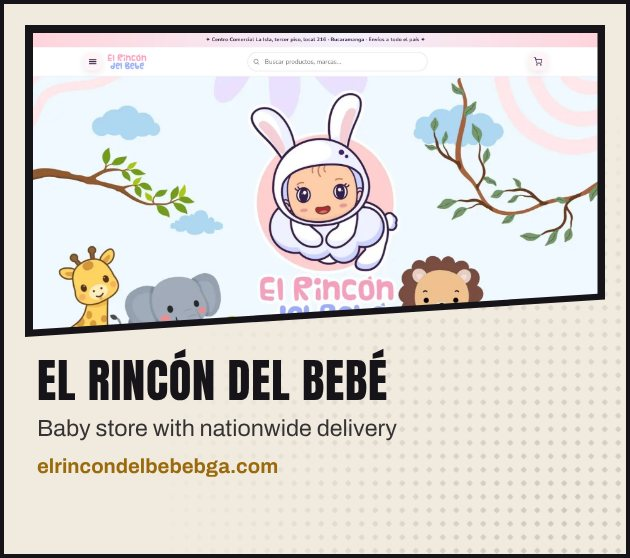</picture></a>
  <a href="https://www.m10drinkslicorera.com/"><picture><source media="(prefers-color-scheme: dark)" srcset="./assets/cards/m10-drinks-dark-v4.jpg" />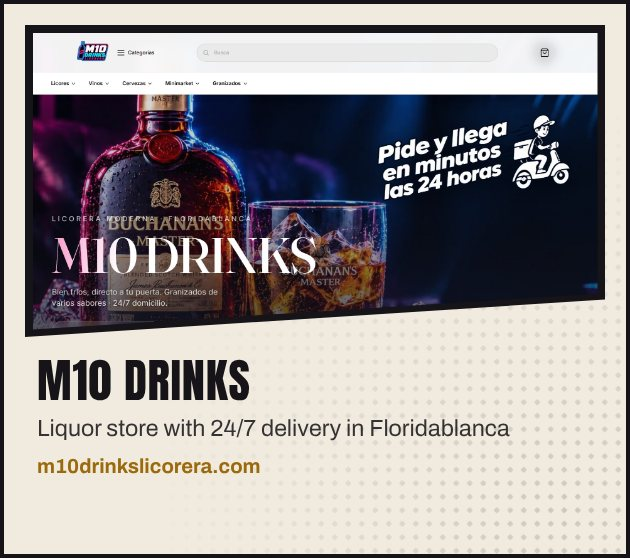</picture></a>
  <a href="https://github.com/cperez233/pass-guard"><picture><source media="(prefers-color-scheme: dark)" srcset="./assets/cards/passguard-dark-v4.jpg" />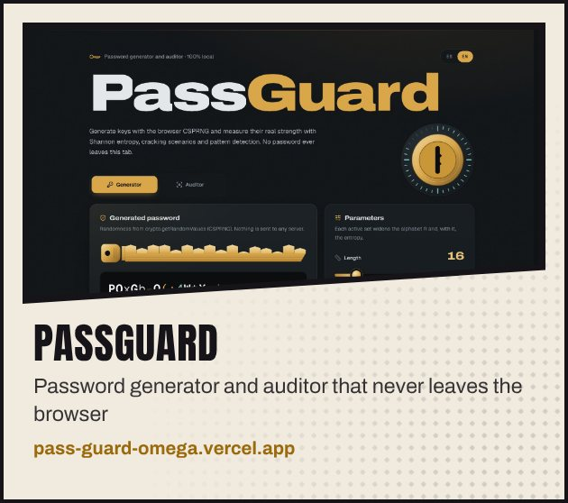</picture></a>
  <a href="https://github.com/cperez233/PairProgramming"><picture><source media="(prefers-color-scheme: dark)" srcset="./assets/cards/pairsync-dark-v4.jpg" />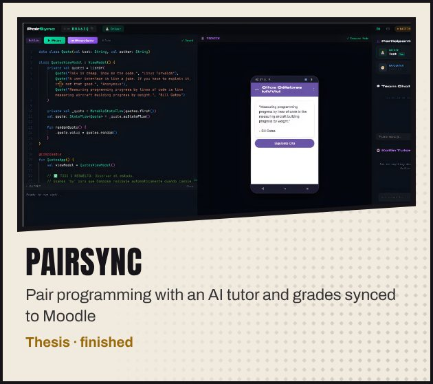</picture></a>
  <a href="https://cristianperez.me"><picture><source media="(prefers-color-scheme: dark)" srcset="./assets/cards/portfolio-dark-v4.jpg" /></picture></a>

<a href="https://cristianperez.me"><b>More work and prices on cristianperez.me →</b></a>

 

<picture>
  <source media="(prefers-color-scheme: dark)" srcset="./assets/part-3-dark.svg" />
  
</picture>

<picture>
  <source media="(prefers-color-scheme: dark)" srcset="./assets/arsenal-dark.svg" />
  
</picture>

<picture>
  <source media="(prefers-color-scheme: dark)" srcset="./assets/languages-dark.svg" />
  
</picture>

 

<picture>
  <source media="(prefers-color-scheme: dark)" srcset="./assets/part-4-dark.svg" />
  
</picture>

<a href="https://github.com/cperez233">
<picture>
  <source media="(prefers-color-scheme: dark)" srcset="https://raw.githubusercontent.com/cperez233/cperez233/output/ora-dark.svg" />
  
</picture>
</a>

<picture>
  <source media="(prefers-color-scheme: dark)" srcset="https://raw.githubusercontent.com/cperez233/cperez233/output/streak-dark.svg" />
  
</picture>

 

<picture>
  <source media="(prefers-color-scheme: dark)" srcset="./assets/approach-dark.svg" />
  
</picture>

  
  
  

Or write straight to <a href="mailto:crisperezm879@gmail.com">crisperezm879@gmail.com</a>

 

<picture>
  <source media="(prefers-color-scheme: dark)" srcset="./assets/tbc-dark.svg" />
  
</picture>
