
<b>English</b> · <a href="README.es.md">Español</a>

  <a href="https://cristianperez.me">
  <picture>
    <source media="(prefers-color-scheme: dark)" srcset="./assets/cover-dark.svg" />
    
  </picture>
  </a>

  
  
  
  
  
  
  
  

 

<picture>
  <source media="(prefers-color-scheme: dark)" srcset="./assets/part-1-dark.svg" />
  
</picture>

I'm Cristian, Cris for short: a Systems Engineer from UNAB, full-stack developer and content creator based in Bucaramanga, Colombia. I build software, websites and apps for businesses, and I make videos as **Tostu**, some of which have gone viral along the way (32K+ followers on TikTok).

I co-founded **[Carpy](https://carpy.tech)**, a software studio with a team behind it: custom software, websites, integrations and security audits for clients in Colombia and abroad. My thesis, PairSync, is done, and the security side comes from working with the cybersecurity team at Fundación Cardiovascular de Colombia, where I built the OCR pipeline for their records and **A Regular Day**, this quarter's security-awareness game.

Most recent: the menu and ordering site for **Cruz Blanca** (a restaurant in Girón), **Jovi's Gioielli** (a jewelry store in Italy, with a live engraving preview), **Sammy Partyboom** (kids' parties in Bucaramanga) and **Hotel Logístico** in Santa Marta, among more than ten sites already live for real businesses.

> **Quotes are open.** I'm working with clients right now and taking new projects: a website that sells, an app your team will actually use, or the system your business already outgrew. Tell me what you need and I'll send you a price.

 

<picture>
  <source media="(prefers-color-scheme: dark)" srcset="./assets/stand-dark.svg" />
  
</picture>

 

<picture>
  <source media="(prefers-color-scheme: dark)" srcset="./assets/part-2-dark.svg" />
  
</picture>

<a href="https://carpy.tech">
<picture>
  <source media="(prefers-color-scheme: dark)" srcset="./assets/cards/carpy-dark.jpg" />
  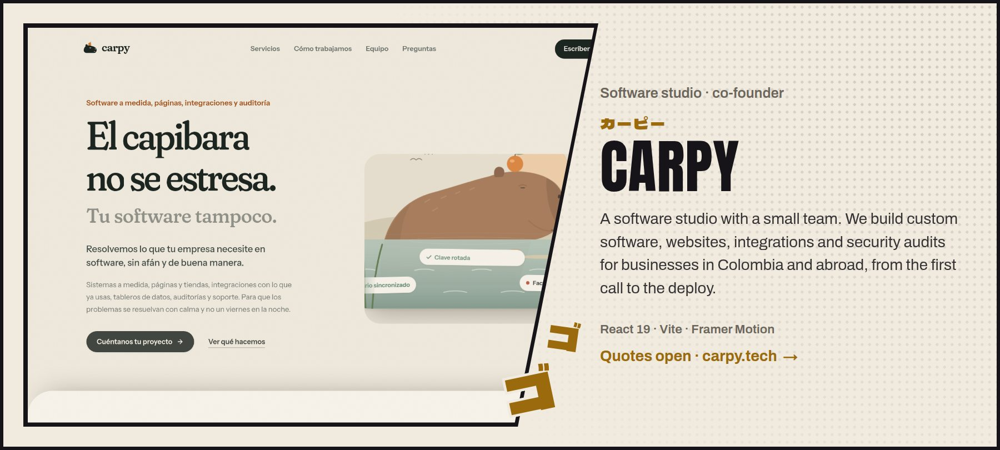
</picture>
</a>

<a href="https://cruz-blanca-red.vercel.app/">
<picture>
  <source media="(prefers-color-scheme: dark)" srcset="./assets/cards/cruz-blanca-dark.jpg" />
  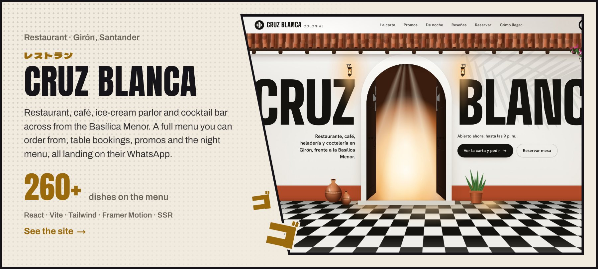
</picture>
</a>

<a href="https://github.com/cperez233/digitalizacion-actas-fcv">
<picture>
  <source media="(prefers-color-scheme: dark)" srcset="./assets/cards/actas-fcv-dark.jpg" />
  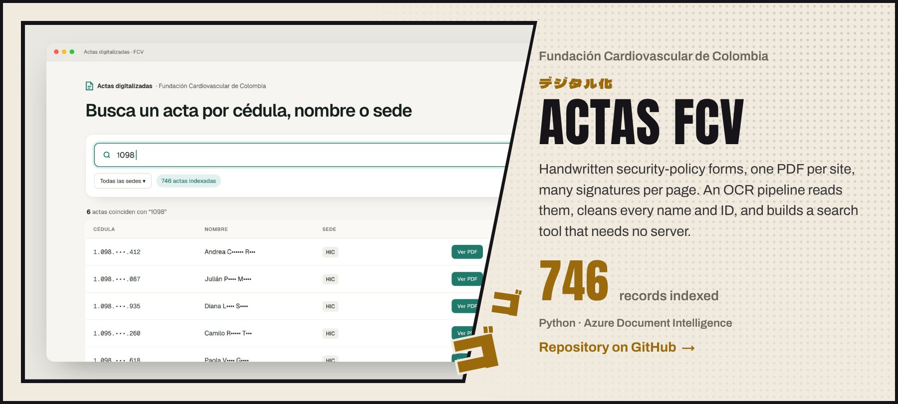
</picture>
</a>

<a href="https://github.com/cperez233/juego-fcv-4trimestre">
<picture>
  <source media="(prefers-color-scheme: dark)" srcset="./assets/cards/juego-fcv-dark.jpg" />
  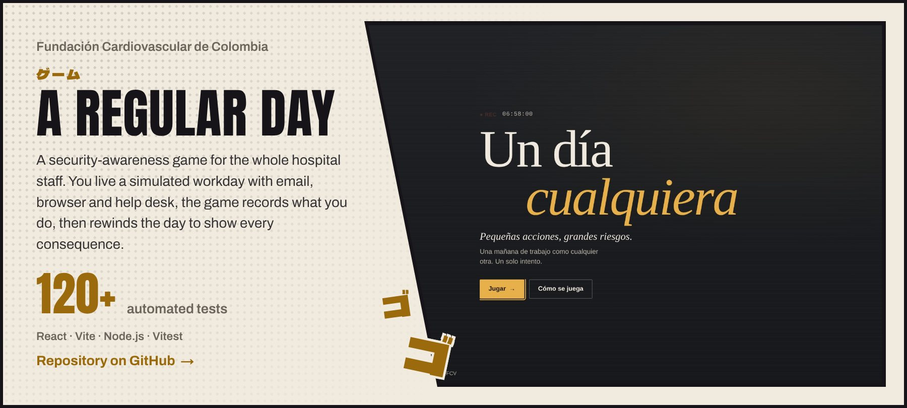
</picture>
</a>

<a href="https://github.com/cperez233/guardenv">
<picture>
  <source media="(prefers-color-scheme: dark)" srcset="./assets/cards/guardenv-dark.jpg" />
  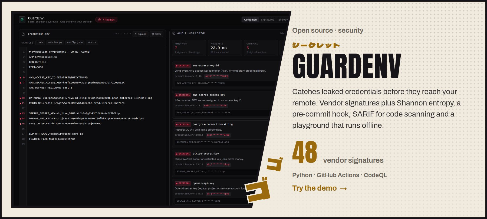
</picture>
</a>

<a href="https://www.tiktok.com/@criscx1905">
<picture>
  <source media="(prefers-color-scheme: dark)" srcset="./assets/cards/content-dark.jpg" />
  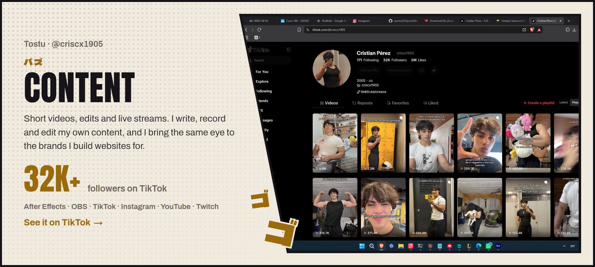
</picture>
</a>

  <a href="https://joyeria-liart.vercel.app/"><picture><source media="(prefers-color-scheme: dark)" srcset="./assets/cards/jovis-gioielli-dark.jpg" />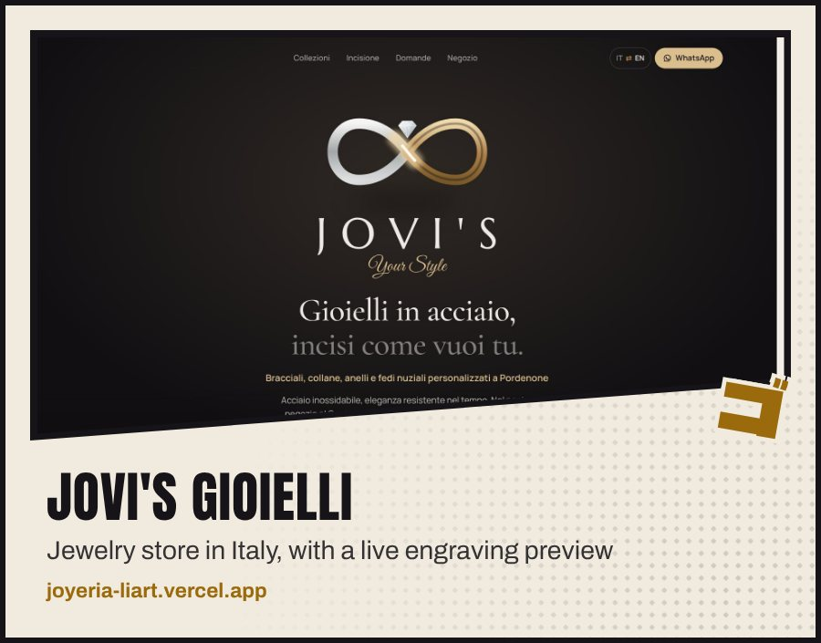</picture></a>
  <a href="https://github.com/cperez233/Sammy"><picture><source media="(prefers-color-scheme: dark)" srcset="./assets/cards/sammy-partyboom-dark.jpg" />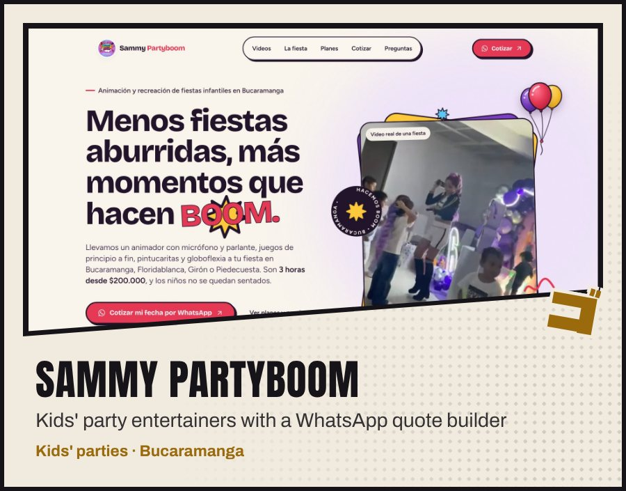</picture></a>
  <a href="https://hotellogistico.com"><picture><source media="(prefers-color-scheme: dark)" srcset="./assets/cards/hotel-logistico-dark.jpg" /></picture></a>
  <a href="https://carros-2.vercel.app/"><picture><source media="(prefers-color-scheme: dark)" srcset="./assets/cards/master-service-quality-dark.jpg" />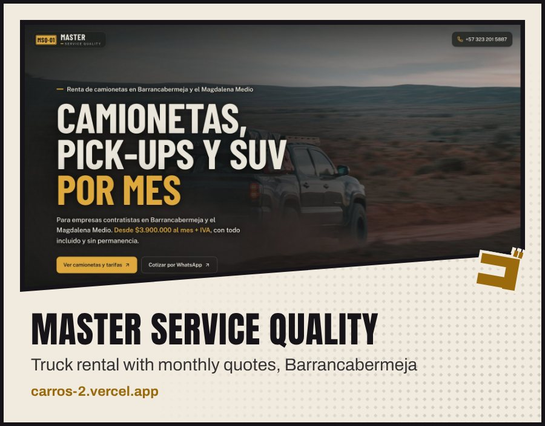</picture></a>
  <a href="https://the-groomers-house.vercel.app/"><picture><source media="(prefers-color-scheme: dark)" srcset="./assets/cards/groomers-house-dark.jpg" />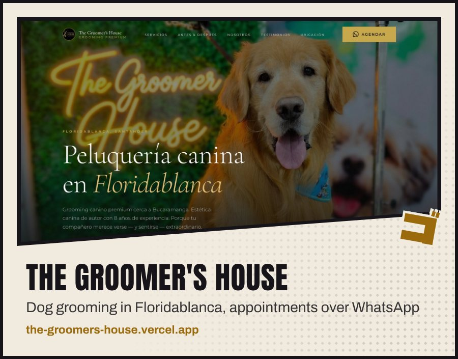</picture></a>
  <a href="https://calzadoleons.com"><picture><source media="(prefers-color-scheme: dark)" srcset="./assets/cards/leons-dark.jpg" />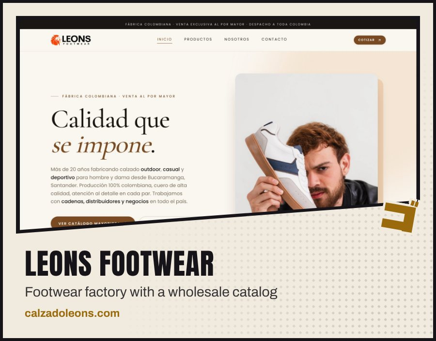</picture></a>
  <a href="https://louloz.com"><picture><source media="(prefers-color-scheme: dark)" srcset="./assets/cards/louloz-dark.jpg" />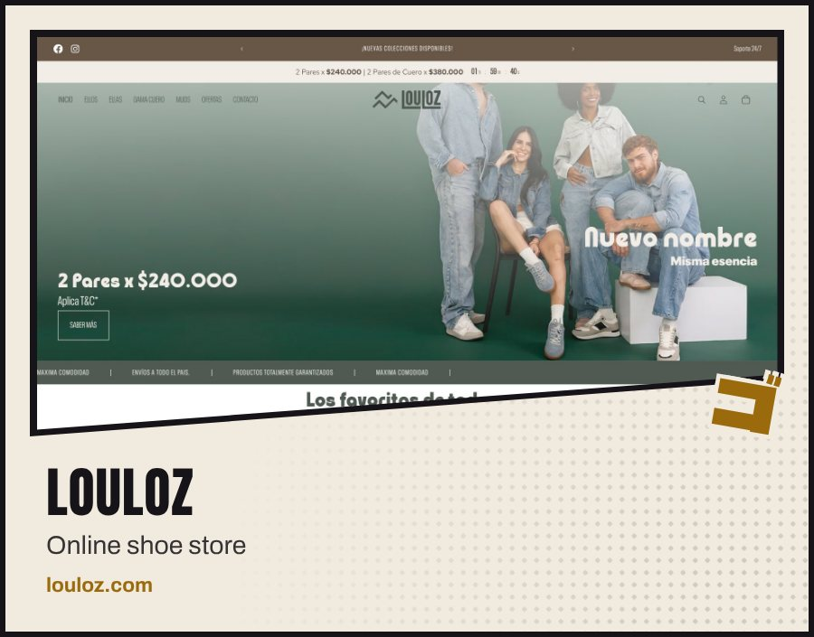</picture></a>
  <a href="https://elrincondelbebebga.com/"><picture><source media="(prefers-color-scheme: dark)" srcset="./assets/cards/rincon-del-bebe-dark.jpg" />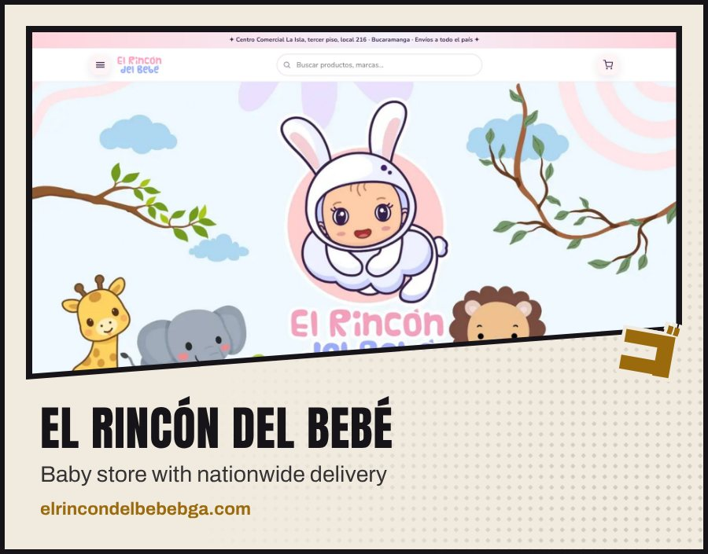</picture></a>
  <a href="https://www.m10drinkslicorera.com/"><picture><source media="(prefers-color-scheme: dark)" srcset="./assets/cards/m10-drinks-dark.jpg" />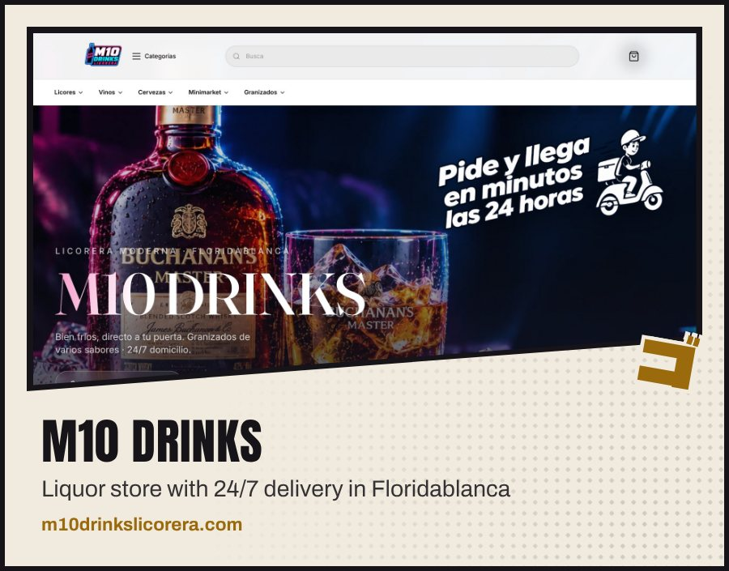</picture></a>
  <a href="https://github.com/cperez233/pass-guard"><picture><source media="(prefers-color-scheme: dark)" srcset="./assets/cards/passguard-dark.jpg" />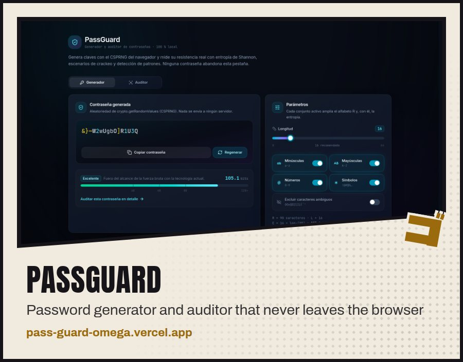</picture></a>
  <a href="https://github.com/cperez233/PairProgramming"><picture><source media="(prefers-color-scheme: dark)" srcset="./assets/cards/pairsync-dark.jpg" />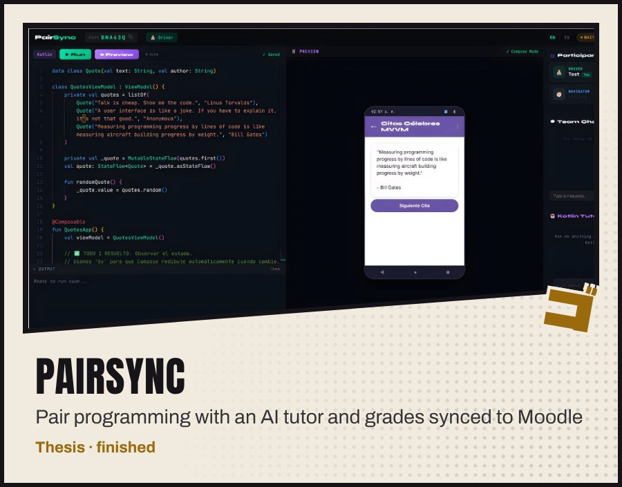</picture></a>
  <a href="https://cristianperez.me"><picture><source media="(prefers-color-scheme: dark)" srcset="./assets/cards/portfolio-dark.jpg" /></picture></a>

<a href="https://cristianperez.me"><b>More work and prices on cristianperez.me →</b></a>

 

<picture>
  <source media="(prefers-color-scheme: dark)" srcset="./assets/part-3-dark.svg" />
  
</picture>

<picture>
  <source media="(prefers-color-scheme: dark)" srcset="./assets/arsenal-dark.svg" />
  
</picture>

  <picture>
    <source media="(prefers-color-scheme: dark)" srcset="https://streak-stats.demolab.com/?user=cperez233&hide_border=true&border_radius=0&background=111013&stroke=2A272C&ring=E3B341&fire=E3B341&currStreakNum=ECE6D8&sideNums=ECE6D8&currStreakLabel=E3B341&sideLabels=9A948A&dates=9A948A" />
    
  </picture>

 

<picture>
  <source media="(prefers-color-scheme: dark)" srcset="./assets/approach-dark.svg" />
  
</picture>

  
  
  

Or write straight to <a href="mailto:crisperezm879@gmail.com">crisperezm879@gmail.com</a>

 

<picture>
  <source media="(prefers-color-scheme: dark)" srcset="./assets/tbc-dark.svg" />
  
</picture>
